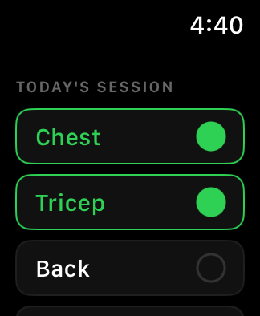
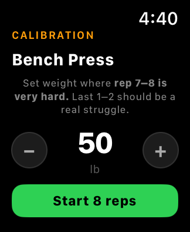
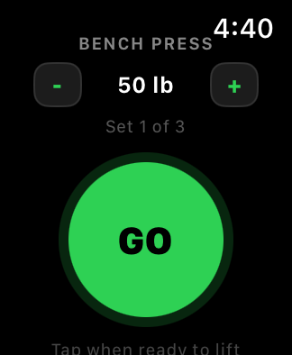
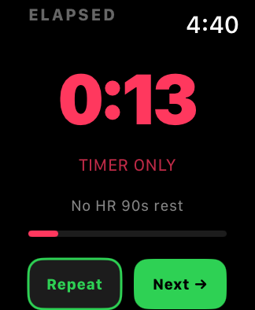
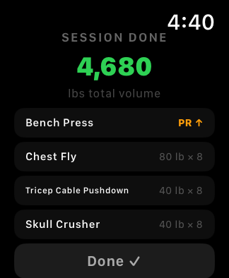

# WristCoach

<p align="center">
  
  
  
  
  
</p>

A hands-mostly-free strength coach for Apple Watch, now growing an iPhone companion. Plan a program on the phone, execute it on the watch, then review the session. WristCoach counts reps from wrist motion, suggests the next load, and times rest against heart rate so your hands stay on the bar.

## What it does

- **Bounded rep counting.** The exercise is chosen before the set, so the detector only watches one known motion pattern inside a GO/STOP window. It never has to guess what lift you are doing.
- **Progressive overload.** Every set produces a next-session weight from reps hit, struggle, and the exercise's own increment.
- **Heart-rate rest gates.** Rest ends when your heart rate recovers toward the target, with a timer-only fallback when health data is unavailable.
- **Audio and haptics.** The watch speaks each rep, calls the last two reps, and announces the set result. Haptics fire on GO, on set completion, and when the detector sees fatigue.
- **Programs (in progress).** Build a named session on iPhone, send it to the watch, and run the planned queue without picking exercises on your wrist.
- **Fully local.** No accounts, no network, no cloud. Records live in SwiftData on the watch and will sync to the phone over WatchConnectivity.

Current watch flow:

```text
Muscle picker -> Exercise queue -> Calibration (first time only) -> Readiness gate
  -> Active set -> Set complete -> Rest -> next exercise or Session summary
```

## Product direction

The next release adds an iPhone companion. The phone becomes the place to plan and review training; the watch stays the place to execute it. The watch remains usable on its own: with no program loaded, the muscle picker flow is unchanged.

| Surface | Status |
|---------|--------|
| Apple Watch app | Working foundation |
| `WristCoachKit` | In progress |
| iPhone app | Planned, needs Xcode |
| Phone to watch sync | Planned |

Shared models, validation, and the sync envelope live in `WristCoachKit`, a platform-neutral Swift package. The phased plan, current status, and daily progress log are in [docs/ROADMAP.md](docs/ROADMAP.md).

## Requirements

| Requirement | Notes |
|-------------|-------|
| macOS with Xcode 26 or later | Project uses the watchOS 26 SDK, Swift 6 language mode, SwiftUI, SwiftData, and Swift Testing |
| Apple Watch Series 6 or later | watchOS 26 or later. Series 4 and earlier are out of scope |
| Apple Developer team | Needed for on-device installs. Simulator builds do not require one |
| Paired iPhone | The watch app is watch-only today. An iPhone companion is in development |

The Xcode project does not pin `WATCHOS_DEPLOYMENT_TARGET`, so builds inherit the default deployment target from the installed watchOS SDK.

## Project layout

```text
WristCoach/
  WristCoachApp.swift     App entry point and SwiftData container
  State/                  WorkoutState and the state machine that drives every screen
  Core/                   Rep detection, set session, overload, HealthKit workout session
    Protocols/            Clock, HapticEngine, HeartRateSource, MotionSource, SpeechAnnouncer
  Models/                 Exercise library, SwiftData records, calibration
  Views/                  One view per screen, plus the screenshot harness
Tests/                    Test bundle sources
  WristCoachTests/        Swift Testing suites
  Fixtures/               Recorded motion fixture for rep detector replay
WristCoachKit/            Shared program models, validation, and sync types
  Sources/
  Tests/
docs/
  ROADMAP.md              iPhone companion plan and daily progress log
scripts/
  test.sh                 Runs the core package tests
.github/workflows/        CI for the core package
AGENTS.md                 Working notes for agents and contributors
DESIGN.md                 Design tokens, accessibility contract, small-watch rules
design-doc.md             Product and engineering design record
TODOS.md                  Deferred work, with context for each item
mocks-v5.html             Visual baseline for the current UI
```

## Setup

### 1. Clone and open

```bash
git clone https://github.com/aniketdivecha/gstack-lift-coach-watchos.git
cd gstack-lift-coach-watchos
open WristCoach.xcodeproj
```

### 2. Select the scheme

Use the `WristCoach` scheme. It builds the `WristCoach` app and includes the `WristCoachTests` bundle in its test action.

### 3. Configure signing

The project is checked in with a specific development team and bundle identifier. To install on your own watch, select the project, then the `WristCoach` target, then Signing & Capabilities:

1. Set **Team** to your own Apple Developer team. The checked-in value is `DEVELOPMENT_TEAM = 2NYW5X384L`.
2. Change the bundle identifier from `com.gstack.wristcoach` if it is already in use in your account.
3. Leave **Automatically manage signing** enabled.

### 4. Confirm HealthKit

The target carries `WristCoach/WristCoach.entitlements` with `com.apple.developer.healthkit`, and `WristCoach/Info.plist` contains the heart rate read and workout write usage strings. Automatic signing creates the capability on your App ID. If Xcode reports a missing capability or profile problem, add HealthKit under Signing & Capabilities and let Xcode regenerate the profile.

### 5. Choose a destination

| Destination | What you get |
|-------------|--------------|
| Apple Watch Simulator | Layout, navigation, and the full state flow. No heart rate, no device motion, no haptics |
| Paired iPhone + Apple Watch | Real behavior: heart rate rest gates, automatic rep counting, audio, haptics |

To run on hardware, unlock the watch and keep it near the paired iPhone, then pick the watch in the destination menu. Xcode installs through the iPhone.

### 6. Run and grant permissions

Press **Run** (Cmd+R). The first workout asks for Health access to read heart rate and save strength workouts.

Motion availability is detected at runtime rather than prompted. If device motion is unavailable, the readiness gate switches to manual rep counting. If health access is denied, it switches to timer-only rest. Neither case blocks the workout.

## Testing

### Unit tests

Run them from Xcode with **Product > Test** (Cmd+U), or from the command line:

```bash
# List installed watch simulators, then use one of the reported names
xcrun simctl list devices available | grep "Apple Watch"

xcodebuild test \
  -project WristCoach.xcodeproj \
  -scheme WristCoach \
  -destination 'platform=watchOS Simulator,name=Apple Watch Series 11 (46mm)'
```

Replace the destination name with one from the list above.

These are logic tests. The `WristCoachTests` target has no test host: the core sources are compiled into both the app target and the test bundle, so the suites run without launching the watch UI. When you add a file under `WristCoach/Core`, `WristCoach/Models`, or `WristCoach/State`, add it to both targets or the tests will not see it.

| Suite | What it covers |
|-------|----------------|
| `RepDetector` | Fixture replay, calibration signatures, final half-rep finalization, outlier rejection |
| `SetSessionController` | Manual mode owning the set result, motion mode returning detector counts |
| `ProgressiveOverload` | Bodyweight loads, exercise increments, minimum weight floor |
| `WorkoutReadiness` | Ready, degraded, and failed gates, including manual rep fallback |
| `WorkoutStateMachine` | Calibration entry for every library exercise, queue order, rest repeat and advance, record logging, recalibration |

Motion fixtures live in `Tests/Fixtures`. `bench_press_8_reps.json` describes sample rate, threshold, baseline noise, peak magnitude, and peak times. `FixtureLoader` synthesizes samples from it and `RepDetectorTests` replays them, which makes rep counting testable without a watch. Add a fixture for each new exercise you want to protect.

### Core package tests

`WristCoachKit` has no Xcode dependency and runs on macOS with the Swift toolchain:

```bash
./scripts/test.sh
```

The script calls `swift test` from `WristCoachKit` and adds the Command Line Tools plugin path when full Xcode is not selected. CI runs the same script on a macOS runner.

### Screenshot harness

Any screen can be opened directly, without walking the flow, by setting `WRISTCOACH_V5_SCREEN`. Set it in the scheme under **Edit Scheme > Run > Arguments > Environment Variables**, or pass it at launch.

| Value | Screen |
|-------|--------|
| `picker` | Muscle picker |
| `queue` | Exercise queue |
| `calibration` | Calibration for the selected exercise |
| `preset`, `preset-up` | GO screen at base weight, GO screen at raised weight |
| `active-preset` | Active set in motion mode |
| `active-manual-over` | Active set in manual mode, over target |
| `counting`, `counting-up` | Counting ring |
| `over-count` | Counting past the target |
| `complete`, `complete-over`, `complete-up` | Set complete, standard and PR-level |
| `rest`, `rest-ready` | Rest waiting on heart rate, rest ready |
| `rest-choice-mock` | Rest with Repeat and Next choices |
| `summary` | Session summary |

Two optional variables refine the fixture: `WRISTCOACH_V5_EXERCISE_ID` selects an exercise from the library (for example `bench_press`), and `WRISTCOACH_V5_WEIGHT` overrides its starting weight.

To capture a screenshot from the terminal:

```bash
xcrun simctl boot "Apple Watch Series 11 (46mm)"
SIMCTL_CHILD_WRISTCOACH_V5_SCREEN=summary xcrun simctl launch booted com.gstack.wristcoach
xcrun simctl io booted screenshot summary.png
```

The app must already be installed on that simulator, for example by running it once from Xcode.

### Manual test pass on device

1. Start a workout with one muscle group and confirm the queue lists its exercises.
2. Calibrate at a weight where reps 7 and 8 are genuinely hard.
3. Confirm the readiness gate reports heart rate, workout session, audio, and auto-count.
4. Lift eight reps and watch the count track the actual reps. Stop and confirm the set completes and a result appears.
5. Check the suggested next weight against the overload rules for that result.
6. Rest and confirm the ring turns green near 115 BPM, then use Repeat or Next to leave early.
7. Finish the session and confirm the summary volume equals the sum of weight times reps.
8. Start a new workout and confirm the last weight for an exercise is prefilled.

## Troubleshooting

| Symptom | Cause and fix |
|---------|---------------|
| Rest is stuck on "Timer-only rest" | Health access was denied or is unavailable. Grant it in Settings > Health > WristCoach, then retry readiness |
| Readiness shows "Manual reps" | Device motion is unavailable. Automatic counting needs a real watch, not the simulator |
| No spoken cues | Audio is not routing to the watch speaker. Check the Watch app under Sounds & Haptics |
| Readiness shows "Workout failed" | `HKWorkoutSession` could not start. Check signing and the HealthKit capability |
| Tests do not see a new core type | The file is missing from the `WristCoachTests` target. Add it to both targets |
| Rep counts consistently high or low | Tune `defaultThreshold` for that exercise, then recalibrate |

## Changelog

### 2026-10-27

- Added a versioned message envelope for phone to watch sync. It can send a program, ask for one, and acknowledge one. Small talk comes later.

### 2026-10-26

- Added next-load suggestions. Hit your reps and add weight, miss badly and take some off, anything in between and run it back.

### 2026-10-25

- Added a JSON program store with atomic writes. A missing file is an empty library, which beats a crash.

### 2026-10-24

- Added a program store protocol and an in-memory implementation. Persistence is still a list, but it is a well-tested list.

### 2026-10-23

- Added sample Push, Pull, and Legs programs. The app now has opinions about leg day.
- Exercise ids are validated before a program can reach the watch. "Bench Press" is a name, not an id.
- Fixed a volume calculation that could overflow on two billion reps. We admire the optimism.
- Moved the local gstack skill pack out of version control. The app is the product; the tooling can live on your machine.

## Documentation

- [DESIGN.md](DESIGN.md) covers tokens, components, accessibility, and small-watch layout rules.
- [design-doc.md](design-doc.md) covers the product problem, UX decisions, rep detection approach, and review history.
- [TODOS.md](TODOS.md) lists deferred work with the reasoning behind each item.
- [docs/ROADMAP.md](docs/ROADMAP.md) covers the iPhone companion plan, phases, and progress log.
- [mocks-v5.html](mocks-v5.html) is the visual baseline for the current screens.

Agent instructions live in [AGENTS.md](AGENTS.md). The local gstack skill pack is ignored by git.

## Contact

- GitHub: [@aniketdivecha](https://github.com/aniketdivecha)
- Reddit: [u/aniketdivecha](https://www.reddit.com/user/aniketdivecha/)

## License

MIT. See [LICENSE](LICENSE).
